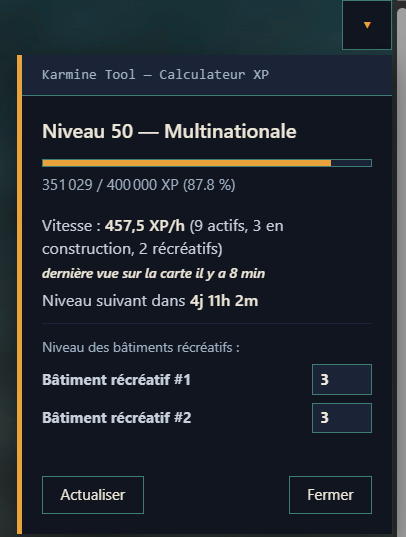
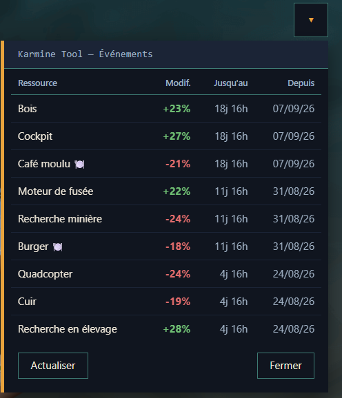
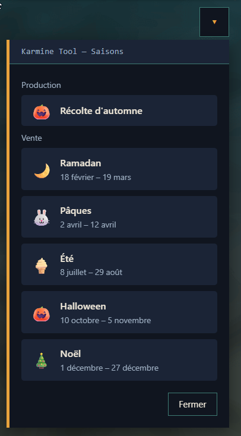

# Karmine Tool

Extension communautaire (script Tampermonkey) pour Sim Companies, développée par un joueur de Karmine Corp.

Installation
💻 Sur ordinateur (Chrome, Firefox, Edge, Brave...)

Étape 1 — Installer l'extension Tampermonkey

Va sur https://www.tampermonkey.net/
Clique sur "Download for [ton navigateur]" (le site détecte automatiquement ton navigateur)
Tu arrives sur la page du Chrome Web Store / Firefox Add-ons (ou équivalent) → clique sur "Ajouter à Chrome" (ou "Ajouter à Firefox")
Confirme en cliquant sur "Ajouter l'extension" dans la fenêtre qui s'ouvre
Une petite icône Tampermonkey (un visage de singe) apparaît en haut à droite de ton navigateur, à côté de la barre d'adresse → c'est que l'extension est bien installée

Étape 2 — Installer le script Karmine Tool

Clique sur ce lien : https://github.com/Dwakoz/karmine-tool/raw/refs/heads/main/karmine-corp-simco-toolkit.user.js
Une page Tampermonkey s'ouvre automatiquement avec un aperçu du script et un bouton vert "Installer"
Clique sur "Installer"
C'est fait ! Rends-toi sur https://www.simcompanies.com et tu verras un nouveau bouton en haut à droite de l'écran (icône verte) pour ouvrir le menu de l'outil

Si rien ne se passe au clic sur le lien (page blanche, ou le fichier se télécharge au lieu de s'installer) :

Vérifie que l'icône Tampermonkey est bien visible dans ton navigateur (étape 1 pas terminée sinon)
Si le fichier .user.js s'est téléchargé sur ton ordinateur : ouvre le dossier Téléchargements, fais un clic-droit sur le fichier téléchargé → "Ouvrir avec" → ton navigateur. Tampermonkey devrait alors proposer l'installation.
En dernier recours : ouvre le tableau de bord Tampermonkey (clique sur son icône → "Dashboard"), onglet "Utilitaires", section "Importer à partir d'une URL", colle ce lien : https://github.com/Dwakoz/karmine-tool/raw/refs/heads/main/karmine-corp-simco-toolkit.user.js, puis clique sur "Installer".

Mettre à jour le script plus tard : Tampermonkey vérifie les mises à jour automatiquement en arrière-plan. Pour forcer une vérification immédiate : icône Tampermonkey → Dashboard → onglet "Utilitaires" → "Check for userscript updates".

📱 Sur mobile
Android

Deux navigateurs permettent d'installer des extensions de bureau comme Tampermonkey :

Firefox pour Android : installe Tampermonkey depuis le store Firefox Android, puis répète l'étape 2 ci-dessus (clique sur le lien d'installation du script) depuis Firefox.
Kiwi Browser (basé sur Chromium) : installe Kiwi Browser depuis le Play Store, puis installe Tampermonkey depuis le Chrome Web Store (Kiwi le permet), et termine avec l'étape 2.

Le script fonctionne normalement sur ces deux navigateurs mobiles.

iPhone / iPad (iOS, Safari)

Tampermonkey n'existe pas officiellement sur iOS. L'alternative existante est l'application gratuite Userscripts (extension Safari), qui permet aussi d'installer des scripts .user.js.

⚠️ Cette solution n'a pas encore été testée avec Karmine Tool — certaines fonctions pourraient ne pas fonctionner correctement. Si tu l'essaies, un retour (Issue ou message en jeu) est le bienvenu pour qu'on sache si ça marche.

Fonctionnalités
Calculateur XP : vitesse d'XP/heure et temps estimé avant le niveau suivant, calculé instantanément à partir des bâtiments actifs sur la carte (production, construction, récréatifs)
Badges VWAP sur la Bourse : repère en un coup d'oeil les annonces sous ou au-dessus du prix moyen du marché, par qualité
Badges VWAP sur les contrats entrants : même repère directement sur les contrats d'achat reçus dans l'Entrepôt
Événements : tableau des événements de production/vente en cours sur ton realm (ressource, modificateur, dates), identique à l'encyclopédie du jeu
Statistiques du royaume : répartition des bâtiments et phase économique en cours, avec recherche et tri
Saisons : dates des saisons de production et de vente, avec lien direct vers la page encyclopédie de chacune
Prix du marché : les prix les plus bas de toutes les ressources en un coup d'oeil, avec recherche, tri, et lien direct vers SimcoTools pour chaque ressource
Outils externes : accès rapide à SimcoTools, Cooper Inc, Simcolike, SimcoGuides et SC Dibbleganger
Annuaire des modérateurs francophones
Personnalisation : couleurs du chat, filtre de couleur sur le jeu, favicon dynamique (niveau), fond d'écran personnalisé sur la carte, masquage du bandeau d'info sur les bâtiments, export/import des réglages
Options : mode restaurant (affiche des détails spécifiques si activé), et choix de la langue de l'outil (français / anglais)

## Aperçu

**Menu**

**Calculateur XP**

**Badges VWAP sur la Bourse**

**Badges VWAP sur les contrats entrants**

**Événements**

**Statistiques du royaume**

**Saisons**

**Prix du marché**

## Retours et bugs

Une idée ou un bug à signaler ? Deux options :

- Ouvre une Issue sur ce repo
- Contacte-moi directement en jeu : KARMINE CORP (https://www.simcompanies.com/fr/company/0/KARMINE-CORP/)

---

Outil non-officiel, développé par un joueur, sans lien avec les développeurs de Sim Companies.
